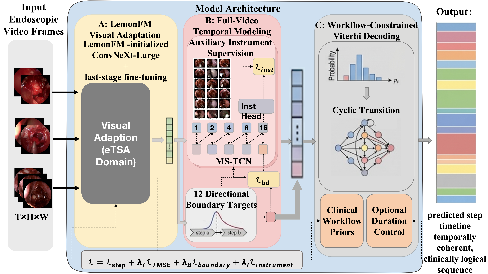
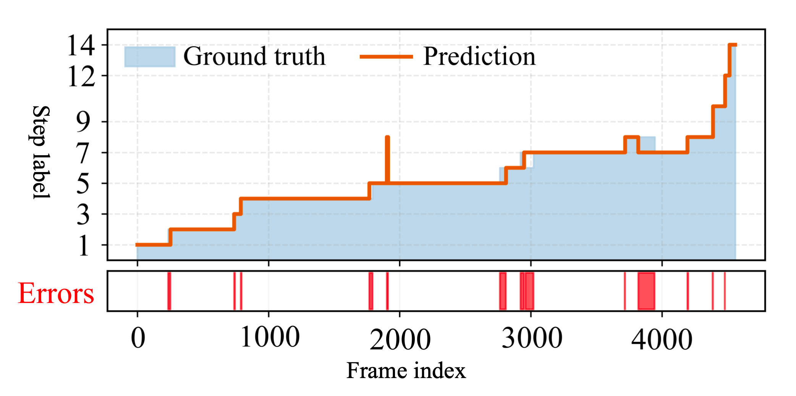
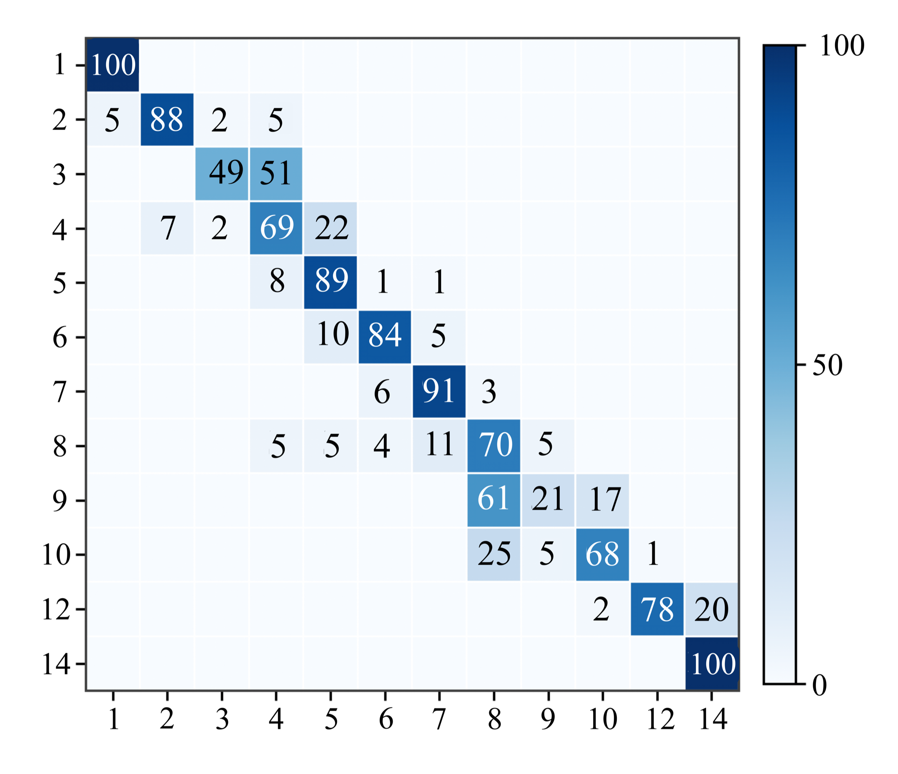

<div align="center">

# WF-PitSeg

### Workflow-aware Surgical Step Segmentation

From endoscopic video frames to coherent surgical step timelines.

**LemonFM · Temporal Modeling · Boundary Supervision · Workflow Decoding**

[Method](#method) · [Results](#results) · [Visual Results](#visual-results) · [Quick Start](#quick-start) · [Code](#code)

</div>

---

WF-PitSeg is an **offline video understanding pipeline for endoscopic pituitary surgery**. It combines a task-adapted surgical vision encoder with full-video temporal modeling and workflow-constrained decoding to recognize surgical steps and reduce fragmented predictions.

| **0.6629 StepMetric** | **+10.50 pp Edit** | **12 surgical steps** |
|:---:|:---:|:---:|
| Default Viterbi decoding | Improvement over raw predictions | PitVis videos sampled at 1 FPS |

<p align="center">
  <a href="assets/framework.png"></a>
  <br>
  <sub>Method overview from the manuscript. Dashed branches provide training-only supervision.</sub>
</p>

## Method

1. **Adapt surgical visual features.** Fine-tune the last feature stage of a LemonFM-initialized ConvNeXt-Large and extract a 1,536-dimensional representation per frame.
2. **Model the complete procedure.** Refine frame predictions with a four-stage MS-TCN, using 10 dilated residual layers and 128 hidden channels per stage.
3. **Learn transitions and auxiliary cues.** Combine step classification, temporal smoothing, instrument supervision, and 12 directional boundary targets with asymmetric Gaussian widths of 3 / 12 frames.
4. **Decode a coherent workflow.** Apply Viterbi decoding with surgical transition constraints to convert frame probabilities into a step sequence.

The default model uses auxiliary instrument supervision and a single temporal checkpoint. Boundary predictions support training and are not direct inputs to the decoder.

## Results

**PitVis public validation split:** 25 videos, with 20 for training and 5 for validation (`01 / 12 / 21 / 24 / 25`). All metrics below are higher-is-better; **StepMetric = (Macro-F1 + Edit) / 2**.

| Decoding | StepMetric ↑ | Macro-F1 ↑ | Edit ↑ |
|:---|---:|---:|---:|
| Raw argmax | 0.6046 | 0.6051 | 0.6042 |
| Light smoothing | 0.6405 | 0.6050 | 0.6761 |
| **Default Viterbi** | **0.6629** | **0.6166** | **0.7092** |
| Prior-calibrated Viterbi* | 0.6891 | 0.6305 | 0.7477 |

Default Viterbi improves **StepMetric by 5.83 percentage points** and **Edit by 10.50 percentage points** over raw predictions from the same checkpoint.

<sub>*Prior-calibrated results use emission priors tuned on this validation split and are reported as development results. Default Viterbi uses fixed decoding settings. These are public validation results.</sub>

## Visual Results

### Following the surgical timeline

<p align="center">
  <a href="assets/qualitative_alignment.png"></a>
  <br>
  <sub>A validation case under prior-calibrated decoding. Blue: ground truth. Orange: prediction. Red: temporal errors.</sub>
</p>

### Understanding the remaining errors

<p align="center">
  <a href="assets/confusion_matrix.png"></a>
  <br>
  <sub>Default Viterbi on the fixed validation split. Rows: ground truth; columns: predictions; values: percentages.</sub>
</p>

The confusion matrix highlights the difficulty of distinguishing neighboring steps. Reporting both Macro-F1 and Edit captures frame classification quality and sequence consistency.

## Additional Experiments

<details>
<summary><strong>Five-fold video-level decoding evaluation</strong></summary>

| Decoding | StepMetric (mean ± std) ↑ | Macro-F1 ↑ | Edit ↑ |
|:---|---:|---:|---:|
| Raw argmax | 0.6368 ± 0.0610 | 0.6784 | 0.5952 |
| Standard Viterbi | 0.6665 ± 0.0639 | 0.6776 | 0.6555 |
| Workflow Viterbi | 0.6683 ± 0.0631 | 0.6785 | 0.6582 |
| Workflow Viterbi + fixed prior | **0.6770 ± 0.0477** | **0.6818** | **0.6723** |

Standard deviations are across five video splits. Transition statistics are estimated from each training fold. The final row uses a prior locked during earlier development, with no per-fold prior search; prior selection is not nested cross-validation.

</details>

<details>
<summary><strong>Visual adaptation and temporal model comparisons</strong></summary>

**Visual adaptation.** Fixed validation split with the same prior-calibrated evaluation procedure:

| Visual representation | StepMetric ↑ | Macro-F1 ↑ |
|:---|---:|---:|
| ImageNet initialization + fine-tuning | 0.6433 | 0.5872 |
| Frozen LemonFM | 0.6424 | 0.5774 |
| **LemonFM + task adaptation** | **0.6891** | **0.6305** |

**Temporal models.** Same visual features, fixed split, seed 42. Scores are StepMetric:

| Model | Temporal params | Raw ↑ | Standard Viterbi ↑ | Workflow Viterbi ↑ | Workflow + fixed prior ↑ |
|:---|---:|---:|---:|---:|---:|
| Framewise | 0.414 M | 0.2455 | 0.3866 | 0.3839 | 0.3756 |
| Vanilla MS-TCN | 3.055 M | **0.5700** | 0.6056 | 0.6038 | 0.6224 |
| MS-TCN++ | 3.712 M | 0.5655 | **0.6349** | 0.6213 | **0.6370** |
| WF-PitSeg–Fusion | 3.073 M | 0.5348 | 0.6272 | **0.6258** | 0.6363 |

Fusion is a separate instrument-feature fusion variant; the default model uses auxiliary instrument supervision. These single-seed comparisons analyze temporal context and decoding, with the best model varying by decoder.

</details>

<details>
<summary><strong>PituPhase65: supervised cross-dataset adaptation</strong></summary>

Seven-phase recognition on 64 usable cases, with a custom patient-level **41 / 10 / 13** train / development / test split. The adapted model uses frozen LemonFM features, a four-stage, 13-layer MS-TCN, EMA 0.99, and label smoothing 0.05.

| Evaluation | Mean patient accuracy ↑ | Global accuracy ↑ | Global Macro-F1 ↑ |
|:---|---:|---:|---:|
| Development · 10 cases | 72.68% | 69.81% | 67.79% |
| **Locked test · 13 cases** | **60.09%** | **61.61%** | **55.55%** |
| Five-fold OOF · 51 development cases | 60.94% | 61.99% | 57.86% |

All scores use strict boundary evaluation and raw predictions. This experiment uses supervised adaptation and a separate seven-phase configuration. The runnable pipeline in this repository targets PitVis.

</details>

<details>
<summary><strong>Offline inference efficiency</strong></summary>

NVIDIA A800 80GB · BF16 · 224 × 224 input · visual batch size 64 · 30,896 sampled frames.

| Measurement | Value |
|:---|---:|
| Visual / temporal parameters | 196.230 M / 3.073 M |
| Visual feature extraction | 197.731 s |
| Temporal inference + fixed-prior decoding | 1.222 s |
| Combined throughput | **155.29 sampled frames/s** |
| Peak GPU memory for sequential stages | 1.641 GB |

Throughput uses the sum of the two stage timings. It includes image loading and preprocessing, and excludes raw-video decoding, feature-file I/O, prior search, and training. The visual benchmark uses a checkpoint with the same backbone architecture at 224-pixel input. This measures offline processing efficiency.

</details>

## Quick Start

### 1. Install

Python 3.9+ and a CUDA GPU are expected for the default training configuration. Experiments used PyTorch 2.4.1, Torchvision 0.19.1, and CUDA 12.1.

```bash
git clone https://github.com/ddqmiao/WF-PitSeg.git
cd WF-PitSeg
python3 -m venv .venv
source .venv/bin/activate
pip install -r requirements.txt
```

### 2. Prepare data and weights

Download the [LemonFM pretrained weights](https://huggingface.co/visurg/LemonFM) to `weights/LemonFM.pth`. Sample video frames at 1 FPS, resize to 224 × 224, and organize the dataset as follows:

```text
data/PitVis/
├── frames_224/
│   ├── video_01/
│   └── ...
└── annotations/
    ├── annotations_01.csv
    └── ...
```

Annotation columns: `int_time`, `int_step`, `int_instrument1`, and `int_instrument2`. Valid step IDs are `1, 2, 3, 4, 5, 6, 7, 8, 9, 10, 12, 14`; names are provided in the [label maps](data/label_maps/). Datasets and model weights are obtained separately.

### 3. Train and evaluate

Run from the repository root:

```bash
export IMAGES_ROOT=data/PitVis/frames_224
export CSV_ROOT=data/PitVis/annotations
export LEMONFM_WEIGHTS=weights/LemonFM.pth
export GPU_IDS=0
export GPU_ID=0

# Adapt the visual backbone
bash scripts/train_backbone.sh

# Extract frame features
export BACKBONE_CHECKPOINT=outputs/vision/backbone_finetune/best_step_metric.pt
export FEATURES_ROOT=outputs/features_finetuned
bash scripts/extract_features.sh

# Train the temporal model
bash scripts/train_main.sh

# Evaluate with fixed decoding priors
export CHECKPOINT=outputs/main/seed_42/best_step_metric.pt
bash scripts/evaluate_main.sh
```

The default configuration is [`configs/main/wfpitseg.json`](configs/main/wfpitseg.json). Evaluation writes metrics in JSON / CSV and frame predictions in CSV to `outputs/evaluation/`. Results depend on the trained checkpoint.

## Code

| Component | Entry points |
|:---|:---|
| Visual and temporal models | [pitvis_mainline_model.py](pitvis_mainline_model.py) |
| Data loading and supervision targets | [pitvis_mainline_data.py](pitvis_mainline_data.py) |
| Training and losses | [train_pitvis_mainline.py](train_pitvis_mainline.py) · [pitvis_mainline_train.py](pitvis_mainline_train.py) |
| Feature extraction | [extract_lemonfm_features.py](extract_lemonfm_features.py) |
| Evaluation and decoding | [ensemble_eval.py](ensemble_eval.py) · [pitvis_mainline_eval.py](pitvis_mainline_eval.py) |
| Workflow transition constraints | [pitvis_transition_policy.py](pitvis_transition_policy.py) |
| Configurations and launch scripts | [configs/](configs/) · [scripts/](scripts/) |

## Acknowledgments

Visual pretraining builds on [LEMON / LemonFM](https://github.com/visurg-ai/LEMON). The three figures above are taken from the WF-PitSeg manuscript.
