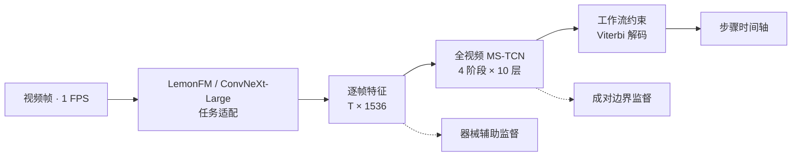
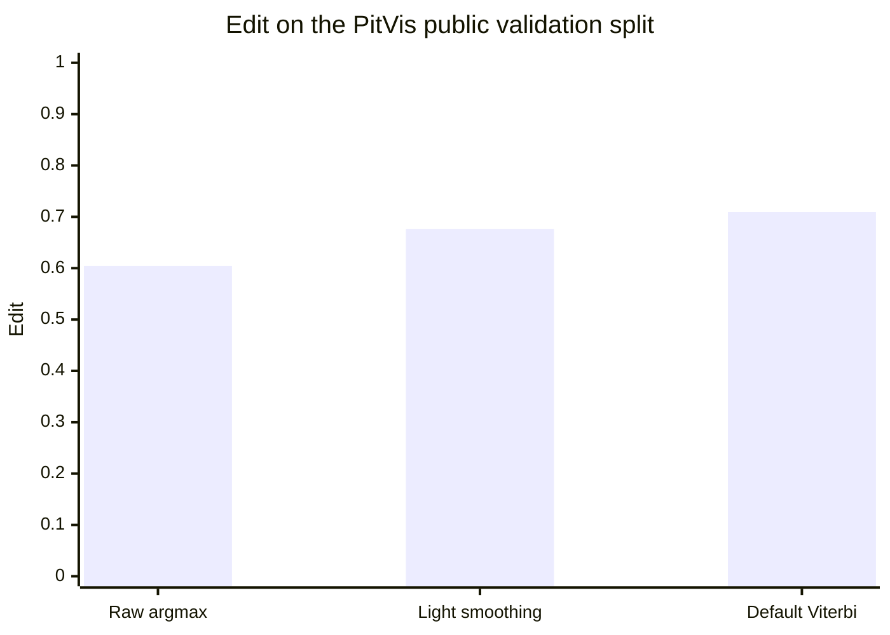

# WF-PitSeg

**Workflow-aware Surgical Step Segmentation**

面向垂体内镜手术视频的离线步骤分割。项目结合 **LemonFM / ConvNeXt-Large 视觉表征、全视频 MS-TCN、成对非对称边界监督和工作流约束 Viterbi 解码**，将逐帧预测转化为连续的手术步骤时间轴。

`PyTorch` · `Computer Vision` · `Video Understanding` · `Temporal Segmentation`

## 项目概览

手术步骤识别既需要区分相似的视觉场景，也需要处理长视频中的步骤切换与预测碎片。WF-PitSeg 使用任务适配后的视觉特征建模整段视频，并将手术流程中的合法转移关系引入序列解码。

- **视觉适配**：以 LemonFM 初始化 ConvNeXt-Large，微调最后一个特征阶段，提取每帧 1536 维表示。
- **长序列建模**：四阶段 MS-TCN，每阶段 10 个膨胀残差层、128 个隐藏通道，逐阶段细化步骤预测。
- **多任务训练**：步骤分类、TMSE 时序平滑、器械辅助监督与 12 个有向转移通道的边界监督；非对称高斯边界的左右尺度为 3 / 12 帧。
- **结构化解码**：利用工作流转移图执行 Viterbi 解码，减少零碎片段与不合理的步骤跳转。



虚线表示训练阶段的辅助分支。默认配置采用器械辅助监督，边界预测不直接输入 Viterbi；主流程使用单个时序 checkpoint。

## 主要结果

以下汇总论文与已完成实验中的代表性结果。`StepMetric = (Macro-F1 + Edit) / 2`，表中指标越高越好。

### PitVis：固定验证集

使用 25 段公开视频中的 20 段训练、5 段验证；验证视频为 `01 / 12 / 21 / 24 / 25`。视频以 **1 FPS** 采样，任务包含 **12 个有效步骤类别**。这些结果对应公开验证集。

| 解码方式 | StepMetric ↑ | Macro-F1 ↑ | Edit ↑ |
|---|---:|---:|---:|
| Raw argmax | 0.6046 | 0.6051 | 0.6042 |
| Light smoothing | 0.6405 | 0.6050 | 0.6761 |
| **Default Viterbi** | **0.6629** | **0.6166** | **0.7092** |
| Prior-calibrated Viterbi¹ | 0.6891 | 0.6305 | 0.7477 |

**Default Viterbi 相比 Raw argmax：StepMetric 提升 5.83 个百分点，Edit 提升 10.50 个百分点。**

¹ Prior-calibrated 使用当前验证集搜索发射概率先验，作为验证集调参结果单独列出；Default Viterbi 使用固定解码设置。

### 五折视频级解码评估

| 解码方式 | StepMetric（均值 ± 标准差）↑ | Macro-F1 ↑ | Edit ↑ |
|---|---:|---:|---:|
| Raw argmax | 0.6368 ± 0.0610 | 0.6784 | 0.5952 |
| Standard Viterbi | 0.6665 ± 0.0639 | 0.6776 | 0.6555 |
| Workflow Viterbi | 0.6683 ± 0.0631 | 0.6785 | 0.6582 |
| Workflow Viterbi + fixed prior | **0.6770 ± 0.0477** | **0.6818** | **0.6723** |

标准差表示五个视频划分之间的差异。转移统计由每折训练视频估计，评估时不执行逐折先验搜索；最后一行使用历史开发阶段锁定的先验，不属于嵌套交叉验证的先验选择。

### 解码效果对比



上图使用固定验证集的汇总指标，比较同一 checkpoint 在三种固定解码设置下的表现。工作流约束对 Edit 的改善更明显，说明其主要收益在于步骤序列的连续性。

<details>
<summary><strong>视觉表征与时序模型对照</strong></summary>

**视觉初始化与任务适配。** 同一固定验证集、相同的先验校准评估流程：

| 视觉表征 | StepMetric ↑ | Macro-F1 ↑ |
|---|---:|---:|
| ImageNet 初始化 + 微调 | 0.6433 | 0.5872 |
| 冻结 LemonFM | 0.6424 | 0.5774 |
| LemonFM + 任务微调 | **0.6891** | **0.6305** |

**时序模型对照。** 固定划分、seed 42、相同视觉特征；以下均为 StepMetric：

| 模型 | 时序参数量 | Raw ↑ | Standard Viterbi ↑ | Workflow Viterbi ↑ | Workflow + fixed prior ↑ |
|---|---:|---:|---:|---:|---:|
| Framewise | 0.414 M | 0.2455 | 0.3866 | 0.3839 | 0.3756 |
| Vanilla MS-TCN | 3.055 M | **0.5700** | 0.6056 | 0.6038 | 0.6224 |
| MS-TCN++ | 3.712 M | 0.5655 | **0.6349** | 0.6213 | **0.6370** |
| WF-PitSeg–Fusion | 3.073 M | 0.5348 | 0.6272 | **0.6258** | 0.6363 |

Fusion 是器械特征融合的独立对照配置，与仓库默认的器械辅助监督配置区分报告。不同解码方式下的最优模型有所变化，因此这些单种子结果主要用于分析时序上下文与解码的作用。

</details>

<details>
<summary><strong>PituPhase65：跨数据集有监督适配</strong></summary>

在 64 个可用病例上采用七阶段标签与自定义患者级 `41 / 10 / 13` 训练、验证、测试划分。适配模型使用冻结 LemonFM 特征、四阶段 13 层 MS-TCN、EMA 0.99 和标签平滑 0.05。

| 评估范围 | 病例平均准确率 ↑ | 全局准确率 ↑ | 全局 Macro-F1 ↑ |
|---|---:|---:|---:|
| 开发集：10 例 | 72.68% | 69.81% | 67.79% |
| **锁定测试集：13 例** | **60.09%** | **61.61%** | **55.55%** |
| 开发集患者级五折 OOF：51 例 | 60.94% | 61.99% | 57.86% |

全部采用严格边界评分、原始模型输出。测试与 OOF 结果接近，开发集成绩较高，反映了患者划分对性能的影响。该实验属于有监督适配，使用独立的七阶段配置；本仓库提供下方的 PitVis 主训练与评估流程。

</details>

### 计算开销

测量环境为 **NVIDIA A800 80GB、BF16、224 × 224 输入**；视觉提取 batch size 为 64，评估集共 30,896 个采样帧。

| 项目 | 结果 |
|---|---:|
| 视觉主干参数量 | 196.230 M |
| 时序模型参数量 | 3.073 M |
| 视觉提取耗时 | 197.731 s |
| 时序推理 + 固定先验解码耗时 | 1.222 s |
| 两阶段合计吞吐量 | **155.29 sampled frames/s** |
| 两阶段顺序执行峰值显存 | 1.641 GB |

吞吐量由两阶段耗时合计得到，包含图像读取和预处理，不含原始视频解码、特征文件读写、先验搜索和训练。视觉测量使用同构主干 checkpoint 在 224 输入下运行；上述数值描述离线处理效率。

## 安装

Python 3.9+；默认训练配置使用 CUDA 和 BF16。实验环境为 PyTorch 2.4.1、Torchvision 0.19.1、CUDA 12.1。

```bash
python3 -m venv .venv
source .venv/bin/activate
pip install -r requirements.txt
```

## 数据准备

将 [LemonFM 预训练权重](https://huggingface.co/visurg/LemonFM)保存为 `weights/LemonFM.pth`，按以下结构准备帧图像和对应标注：

```text
data/PitVis/
├── frames_224/
│   ├── video_01/
│   └── ...
└── annotations/
    ├── annotations_01.csv
    └── ...
```

标注列包括 `int_time`、`int_step`、`int_instrument1` 和 `int_instrument2`。有效步骤 ID 为 `1, 2, 3, 4, 5, 6, 7, 8, 9, 10, 12, 14`；步骤与器械名称见 [标签映射](data/label_maps/)。数据集与模型权重需单独准备。

## 运行

在仓库根目录执行：

```bash
export IMAGES_ROOT=data/PitVis/frames_224
export CSV_ROOT=data/PitVis/annotations
export LEMONFM_WEIGHTS=weights/LemonFM.pth
export GPU_IDS=0
export GPU_ID=0

# 1. 微调视觉主干
bash scripts/train_backbone.sh

# 2. 提取逐帧特征
export BACKBONE_CHECKPOINT=outputs/vision/backbone_finetune/best_step_metric.pt
export FEATURES_ROOT=outputs/features_finetuned
bash scripts/extract_features.sh

# 3. 训练时序模型
bash scripts/train_main.sh

# 4. 评估
export CHECKPOINT=outputs/main/seed_42/best_step_metric.pt
bash scripts/evaluate_main.sh
```

默认训练配置为 [`configs/main/wfpitseg.json`](configs/main/wfpitseg.json)。评估使用固定先验，输出位于 `outputs/evaluation/`，包含指标 JSON、指标 CSV 和逐帧预测 CSV；重新训练的结果随 checkpoint 而变化。

## 主要代码

| 文件 | 功能 |
|---|---|
| [pitvis_mainline_model.py](pitvis_mainline_model.py) | 视觉主干与时序模型 |
| [pitvis_mainline_data.py](pitvis_mainline_data.py) | 数据加载与监督目标生成 |
| [pitvis_mainline_train.py](pitvis_mainline_train.py) | 损失函数与训练循环 |
| [train_pitvis_mainline.py](train_pitvis_mainline.py) | 训练入口 |
| [extract_lemonfm_features.py](extract_lemonfm_features.py) | 特征提取 |
| [ensemble_eval.py](ensemble_eval.py) | checkpoint 评估入口 |
| [pitvis_mainline_eval.py](pitvis_mainline_eval.py) | 解码与指标计算 |
| [pitvis_transition_policy.py](pitvis_transition_policy.py) | 工作流转移约束 |
| [configs/](configs/) | 视觉微调与时序训练配置 |
| [scripts/](scripts/) | 主干微调、特征提取、时序训练与评估脚本 |

视觉预训练模型来自 [LEMON / LemonFM](https://github.com/visurg-ai/LEMON)。
